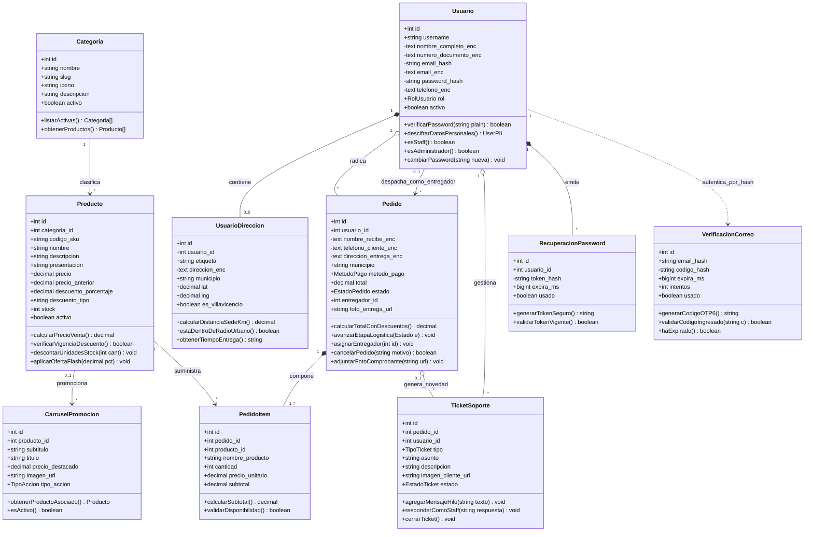

# 📊 Diagramas de Arquitectura de Datos y Dominio — Danillanos

Este directorio contiene la documentación gráfica y técnica oficial del modelado relacional y la arquitectura de software de la plataforma **Danillanos**.

---

## 📂 Archivos Disponibles en este Directorio

| Archivo | Formato | Descripción |
|---|---|---|
| 🌐 [**`diagrama_interactivo.html`**](diagrama_interactivo.html) | HTML5 Interactivo | **Visor web dinámico** con navegación por pestañas (E-R vs UML), zoom fluido con rueda del ratón, arrastre para desplazamiento (*pan*) y descarga directa en 1 clic. |
| 🖼️ [**`diagrama_er_danillanos.svg`**](diagrama_er_danillanos.svg) | Gráfico Vectorial SVG | **Diagrama Entidad-Relación (E-R)** en alta definición vectorial, mostrando las 10 tablas MySQL, llaves primarias, foráneas, tipos de datos, índices y cifrado. |
| 🖼️ [**`diagrama_uml_danillanos.svg`**](diagrama_uml_danillanos.svg) | Gráfico Vectorial SVG | **Diagrama de Clases UML** estructurado bajo principios de Domain-Driven Design (DDD): entidades, objetos de valor (*Value Objects*), servicios de seguridad y operaciones. |
| 📝 **`README.md`** | Markdown Técnico | Especificación arquitectónica, diccionario de datos y diagramas renderizables en GitHub mediante sintaxis nativa de **Mermaid**. |

---

## 🗄️ 1. Diagrama Entidad - Relación (E-R)

A continuación se presenta el modelo relacional formal de la base de datos `danillanos_db` ejecutado en MySQL 8.0+:

```mermaid
erDiagram
    CATEGORIAS ||--|{ PRODUCTOS : "1 clasifica a N"
    PRODUCTOS ||--o{ CARRUSEL_PROMOCIONES : "0..1 destaca en N"
    USUARIOS ||--o{ USUARIO_DIRECCIONES : "1 posee 0..5"
    USUARIOS ||--o{ PEDIDOS : "1 radica N"
    USUARIOS ||--o{ PEDIDOS : "0..1 reparte N (entregador)"
    PEDIDOS ||--|{ PEDIDO_ITEMS : "1 contiene 1..N"
    PRODUCTOS ||--o{ PEDIDO_ITEMS : "1 abastece N"
    PEDIDOS ||--o{ TICKETS_SOPORTE : "0..1 genera N"
    USUARIOS ||--o{ TICKETS_SOPORTE : "1 abre N"
    USUARIOS ||--o{ RECUPERACIONES_PASSWORD : "1 solicita N"
    USUARIOS ||--o{ VERIFICACIONES_CORREO : "asociado por email_hash"

    CATEGORIAS {
        int id PK "Auto Increment"
        varchar nombre "Nombre de la categoría"
        varchar slug UK "Identificador URL único"
        varchar icono "Icono Material Symbols"
        varchar descripcion "Detalle comercial"
        tinyint activo "Estado lógico (1/0)"
        timestamp creado_en "Fecha de registro"
    }

    PRODUCTOS {
        int id PK "Auto Increment"
        int categoria_id FK "Referencia a categorias"
        varchar codigo_sku UK "Código único de inventario"
        varchar nombre "Nombre del insumo/cárnico"
        text descripcion "Especificaciones y usos"
        varchar presentacion "Ej: Caja x30, Bolsa 1kg"
        decimal precio "Precio actual de venta"
        decimal precio_anterior "Precio regular previo"
        decimal descuento_porcentaje "Porcentaje de oferta"
        varchar descuento_tipo "manual, flash, unidades"
        datetime descuento_expira_en "Vigencia temporal"
        bigint descuento_expira_ms "Timestamp de expiración"
        int descuento_unidades_limite "Límite de unidades en promo"
        int descuento_unidades_vendidas "Contador de ventas promo"
        varchar imagen_url "Fotografía del catálogo"
        int stock "Inventario disponible"
        tinyint es_mas_vendido "Flag de popularidad"
        varchar etiqueta "Badge visual"
        varchar temperatura_conservacion "Ambiente, 0-4°C, Congelado"
        tinyint activo "Visibilidad en catálogo"
        timestamp creado_en "Creación"
    }

    CARRUSEL_PROMOCIONES {
        int id PK "Auto Increment"
        int producto_id FK "Producto enlazado (opcional)"
        varchar subtitulo "Texto secundario superior"
        varchar titulo "Titular de impacto"
        varchar descripcion "Copia publicitaria"
        decimal precio_destacado "Precio exhibido en banner"
        varchar imagen_url "Imagen de fondo hero"
        varchar texto_boton "CTA (Llamado a la acción)"
        enum tipo_accion "add_to_cart, buy_now, ver_catalogo"
        int orden "Secuencia de visualización"
        tinyint activo "Visibilidad en carrusel"
    }

    USUARIOS {
        int id PK "Auto Increment"
        varchar username "Identificador de usuario"
        text nombre_completo_enc "Cifrado AES-256-GCM"
        text nombres_enc "Cifrado AES-256-GCM"
        text apellidos_enc "Cifrado AES-256-GCM"
        text empresa_enc "Razón social cifrada"
        varchar tipo_documento "CC, NIT, CE, Pasaporte"
        text numero_documento_enc "Documento cifrado"
        varchar email_hash UK "HMAC-SHA256 (Blind Index)"
        text email_enc "Correo cifrado AES-256-GCM"
        varchar password_hash "Hash Scrypt KDF + Salt"
        text google_id_enc "ID OAuth Google cifrado"
        text telefono_enc "Celular cifrado"
        varchar avatar_url "URL de imagen de perfil"
        enum rol "cliente, empleado, bodega, entregador, soporte, admin"
        tinyint activo "Habilitación de cuenta"
        timestamp creado_en "Fecha de registro"
    }

    USUARIO_DIRECCIONES {
        int id PK "Auto Increment"
        int usuario_id FK "Propietario de la dirección"
        varchar etiqueta "Ej: Sede Principal, Casa"
        text direccion_enc "Nomenclatura cifrada AES-256-GCM"
        varchar barrio_referencia "Barrio o punto de referencia"
        varchar municipio "Villavicencio u otro del Meta"
        varchar departamento "Meta"
        decimal lat "Latitud GPS (10,7)"
        decimal lng "Longitud GPS (10,7)"
        tinyint es_villavicencio "Flag de radio urbano (9.5km)"
        varchar tiempo_entrega_estimado "Texto informativo de entrega"
        tinyint es_principal "Dirección por defecto"
        timestamp creado_en "Fecha de guardado"
    }

    PEDIDOS {
        int id PK "Auto Increment"
        int usuario_id FK "Cliente que emite la orden"
        text nombre_recibe_enc "Receptor cifrado AES-256-GCM"
        text telefono_cliente_enc "Celular cifrado AES-256-GCM"
        text direccion_entrega_enc "Dirección cifrada AES-256-GCM"
        varchar municipio "Municipio de destino"
        decimal lat "Latitud de entrega"
        decimal lng "Longitud de entrega"
        tinyint es_villavicencio "Flag urbano"
        varchar tiempo_entrega_estimado "Compromiso de entrega"
        enum metodo_pago "pse, nequi, bancolombia, tarjeta, efectivo"
        varchar referencia_pago "Referencia bancaria/factura"
        decimal total "Monto liquidado final"
        enum estado "pendiente, en_proceso, en_camino, entregado, cancelado"
        text observaciones_cliente "Notas del pedido"
        text razon_cancelacion "Motivo de anulación"
        enum reembolso_estado "no_aplica, reembolsado"
        int entregador_id FK "Colaborador de reparto asignado"
        text observaciones_entregador "Novedades en ruta"
        longtext foto_entrega_url "Prueba fotográfica de entrega"
        datetime fecha_confirmacion "Hora de confirmación en bodega"
        datetime fecha_entrega "Hora de recepción efectiva"
        timestamp creado_en "Radicación"
    }

    PEDIDO_ITEMS {
        int id PK "Auto Increment"
        int pedido_id FK "Orden asociada"
        int producto_id FK "Artículo adquirido"
        varchar nombre_producto "Snapshot del nombre"
        int cantidad "Unidades solicitadas"
        decimal precio_unitario "Precio unitario pactado"
        decimal subtotal "Subtotal (precio * cantidad)"
    }

    TICKETS_SOPORTE {
        int id PK "Auto Increment"
        int pedido_id FK "Pedido con novedad (opcional)"
        int usuario_id FK "Cliente solicitante"
        enum tipo "envio, pago, producto, reembolso, otro"
        varchar asunto "Resumen de la incidencia"
        text descripcion "Detalle de la solicitud"
        longtext imagen_cliente_url "Evidencia fotográfica (ej. vencimiento)"
        enum estado "abierto, en_revision, resuelto"
        text respuesta_soporte "Resolución de atención"
        timestamp creado_en "Apertura"
    }

    VERIFICACIONES_CORREO {
        int id PK "Auto Increment"
        varchar email_hash "Índice HMAC del correo"
        varchar codigo_hash UK "HMAC de código OTP 6 dígitos"
        bigint expira_ms "Timestamp epoch de caducidad"
        int intentos "Contador de fallos (máx 5)"
        tinyint usado "Flag de un solo uso"
        timestamp creado_en "Emisión"
    }

    RECUPERACIONES_PASSWORD {
        int id PK "Auto Increment"
        int usuario_id FK "Usuario a restablecer"
        varchar email_hash "Índice del correo"
        varchar token_hash UK "Token seguro HMAC"
        bigint expira_ms "Timestamp de caducidad (10m)"
        tinyint usado "Flag de consumo"
        timestamp creado_en "Generación"
    }
```

---

## 🏛️ 2. Diagrama de Clases UML (Domain Model)

El diagrama de clases representa el modelo de objetos del software siguiendo patrones de **Domain-Driven Design (DDD)** y arquitectura en capas:

---

## 🔒 3. Consideraciones de Seguridad Criptográfica en el Esquema

1. **Cifrado Simétrico en Reposo (AES-256-GCM)**:
   - Los campos con el sufijo `_enc` almacenan cadenas con formato `enc:ivHex:authTagHex:cipherHex`.
   - Se utiliza un vector de inicialización (IV) criptográfico único de 12 bytes por registro y una etiqueta de autenticación (*Auth Tag*) de 16 bytes que previene modificaciones no autorizadas a nivel de base de datos.
2. **Búsqueda Indexada Ciega (*Blind Indexing*)**:
   - Para no vulnerar la privacidad de los usuarios con correos en texto plano ni perder la capacidad de búsqueda exacta O(1), la columna `email_hash` utiliza un resumen determinista **HMAC-SHA256** derivado con una clave secreta del servidor.
3. **Derivación de Contraseñas (*Scrypt KDF*)**:
   - `password_hash` almacena la sal aleatoria de 16 bytes y la clave derivada de 64 bytes (`saltHex:derivedKeyHex`), evaluada con `crypto.timingSafeEqual` para anular ataques de temporización.
4. **Restricciones de Integridad Referencial**:
   - `fk_producto_categoria`: `ON DELETE RESTRICT` impide eliminar categorías con productos vigentes.
   - `fk_item_pedido`: `ON DELETE CASCADE` garantiza consistencia si se depura un pedido.
   - `fk_direccion_usuario` y `fk_recuperacion_usuario`: `ON DELETE CASCADE` depuran automáticamente datos dependientes al suprimir un usuario.
